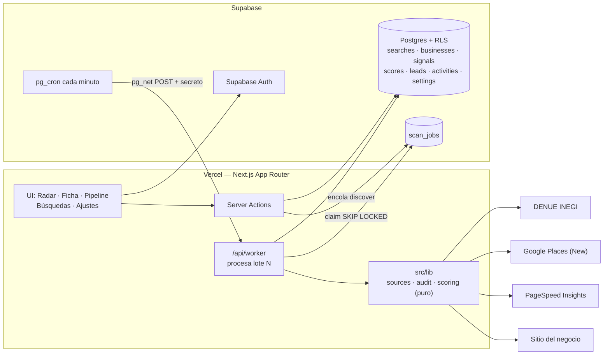
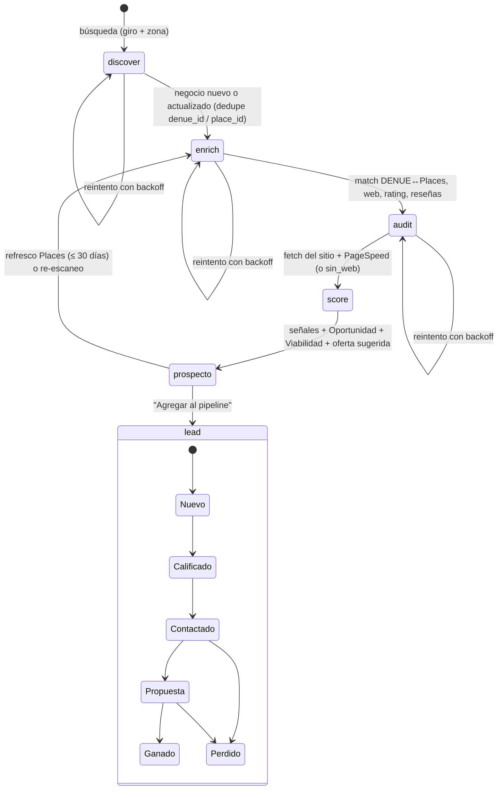

# Radar de Clientes — Producto

## Estado de implementación — 25 de octubre de 2026

Disponible: login, búsqueda DENUE por giro y estado, cola con reintentos, resultados paginados, historial, pipeline con cambio de etapa y análisis manual de prospectos (auditoría web, señales, score y oferta sugerida). Se permite agregar manualmente un negocio al pipeline antes de auditarlo. Ver [ADR 0005](adr/0005-primer-flujo-de-descubrimiento.md) y el README para configuración y pruebas.

Las secciones siguientes describen la visión completa: Places, auditoría automática en segundo plano, agentes de IA, mapa, recordatorios y re-escaneos programados todavía están pendientes.

## Visión

Herramienta personal para que un desarrollador fullstack freelancer **encuentre negocios en todo México que necesitan digitalizarse**, entienda por qué (con evidencia), sepa qué ofrecerles (Landing, Rediseño o Sistema a medida) y les dé seguimiento hasta cerrar la venta. Pasar de "buscar clientes a ciegas" a "una lista priorizada con argumentos de venta".

## Usuario

Un solo usuario: el freelancer. Conoce de tecnología, tiene poco tiempo y presupuesto cero para herramientas. Contacta manualmente (llamada, WhatsApp, email). El diseño (RLS por `owner_id`) permite convertirlo en SaaS más adelante.

## Flujos principales

1. **Radar** — Elige giro + zona (estado/municipio o punto en el mapa + radio) y lanza un escaneo. Ve el progreso y luego una tabla y un mapa de prospectos filtrables por score, señal, oferta sugerida y tiene/no tiene web. Acción: "Agregar al pipeline".
2. **Ficha del prospecto** — Datos de contacto (botón `wa.me` y llamada), auditoría web con métricas, señales con su evidencia, score desglosado (Oportunidad + Viabilidad), oferta sugerida, notas y actividades.
3. **Pipeline** — Kanban por etapa (Nuevo → Calificado → Contactado → Propuesta → Ganado/Perdido) con recordatorios de próxima acción.

Complementarios: **Búsquedas guardadas** (re-escaneo programado y aviso de prospectos nuevos) y **Ajustes** (pesos del score, API keys, consumo de cuota de Places).

## Glosario de dominio

| Término | Definición |
|---|---|
| **Negocio** | Establecimiento descubierto (DENUE y/o Google Places). Tabla `businesses`. |
| **Prospecto** | Negocio que ya fue enriquecido, auditado y puntuado, y aparece en el Radar como posible cliente. |
| **Lead** | Prospecto que el usuario agregó al pipeline para darle seguimiento. Tabla `leads`. |
| **Señal** | Hecho observable con evidencia que indica necesidad o capacidad de pago: `sin_web`, `web_mala`, `procesos_manuales`, `actividad`. Tabla `signals`. |
| **Score** | Puntaje 0–100 = Oportunidad (0–60, necesidad de digitalizarse) + Viabilidad (0–40, capacidad y probabilidad de compra). Tabla `scores`. |
| **Oferta sugerida** | Servicio recomendado según las señales: Landing, Rediseño o Sistema a medida. |
| **Etapa** | Posición del lead en el pipeline: Nuevo, Calificado, Contactado, Propuesta, Ganado, Perdido. |
| **Actividad** | Interacción registrada sobre un lead: nota, llamada, WhatsApp, email, propuesta. |
| **Búsqueda** | Combinación giro + zona que origina un escaneo; puede re-escanearse. Tabla `searches`. |
| **Job** | Unidad de trabajo en segundo plano (`discover`, `enrich`, `audit`, `score`). Tabla `scan_jobs`. |

## Arquitectura

Monolito modular Next.js + Supabase; cola de jobs en Postgres disparada por `pg_cron` (ver ADRs 0001–0004 en `docs/adr/`).

## Ciclo de vida de un negocio

## Fuera del MVP

Mensajes y propuestas con IA a partir de la auditoría, análisis de reseñas con LLM, outreach automático por email y versión SaaS.
